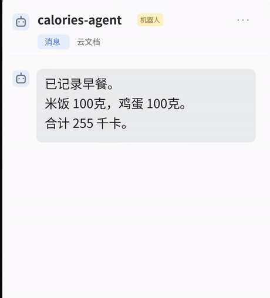
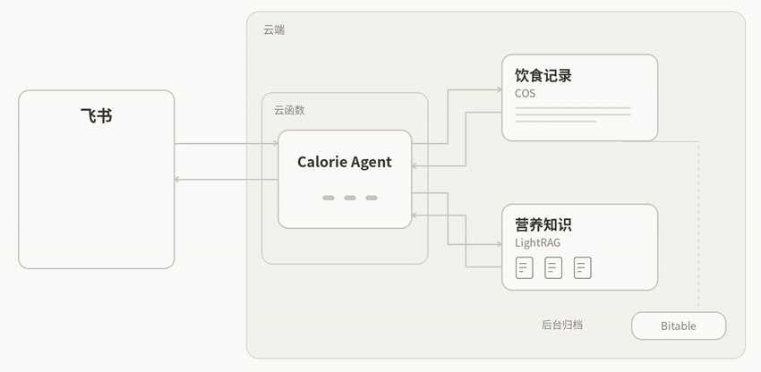

<h1 align="center">Calorie Agent</h1>

<p align="center">
  <a href="#飞书演示"></a>
  <a href="#本地运行"></a>
  <a href="LICENSE"></a>
</p>

<p align="center">
  <a href="#飞书演示">飞书演示</a> ·
  <a href="#本地运行">本地运行</a> ·
  <a href="#云函数部署">云函数部署</a> ·
  <a href="#文档">文档</a>
</p>


Calorie Agent 是个飞书机器人，用来记每天吃了什么。记错了份量，可以直接在同一个对话里改。

## 飞书演示

早餐记了 100 克米饭和 100 克鸡蛋。发一句「米饭改成 50 克」，鸡蛋照旧，这餐的合计从 255 千卡变成了 197 千卡。

<p align="center">
  
</p>

也可以查今天一共吃了多少，或按剩下的热量安排晚饭。问营养问题时，机器人会查资料并给出找到的出处。

## 本地运行

准备 Python 3.12 或更新版本，并把 DeepSeek API Key 设置为环境变量 `DEEPSEEK_API_KEY`。命令行会联网调用 DeepSeek，饮食记录保存在内存里，退出后清空。

在仓库根目录用 PowerShell 运行以下命令。

```powershell
py -3 -m venv .venv
.\.venv\Scripts\python.exe -m pip install -r requirements.txt
.\.venv\Scripts\python.exe cli.py
```

在 Linux 或 macOS 上，用 `python3` 创建虚拟环境，后两条命令用 `.venv/bin/python`。

启动后依次输入这两条消息，每条按一次回车。

```text
记录今天早餐：米饭 100 克、鸡蛋 100 克。
刚才的米饭改成 50 克。
```

在输出的 `reply:` 行看回复。第二条会把米饭改为 50 克，鸡蛋仍是 100 克。命令行用的是仓库附带的食物数据。

## 云函数部署

要在自己的飞书里使用，需要配置飞书应用、腾讯云函数、COS 和多维表格。配置项和发布命令见[部署说明](docs/operations.md#接入飞书)。

### 知识维护与发布

营养资料在飞书多维表格里维护。修改后按[知识库发布步骤](docs/operations.md#知识维护与发布)更新检索索引。

## 实现

助手用 LangChain 的 `create_agent` 运行。模型理解消息并选择工具，食物匹配、营养计算和账本读写由工具完成。饮食记录先存到腾讯云对象存储（COS），再由后台归档到飞书多维表格。

<details>
<summary>查看记餐和营养问答的处理过程</summary>



</details>

## 文档

- [产品范围](REQUIREMENTS.md) · [饮食记录和计划](PERSONAL_CALORIE_SPEC.md) · [对话行为](CONVERSATION_EXPERIENCE_SPEC.md)
- [本地控制台与 DSH](docs/operations.md#本地控制台与-dsh) · [运行评测](docs/operations.md#运行评测) · [存储和接口](contracts/)
- [部署记录](reports/LATENCY_DELIVERY.md) · [早期版本](legacy/README.md) · [MIT 许可证](LICENSE)
